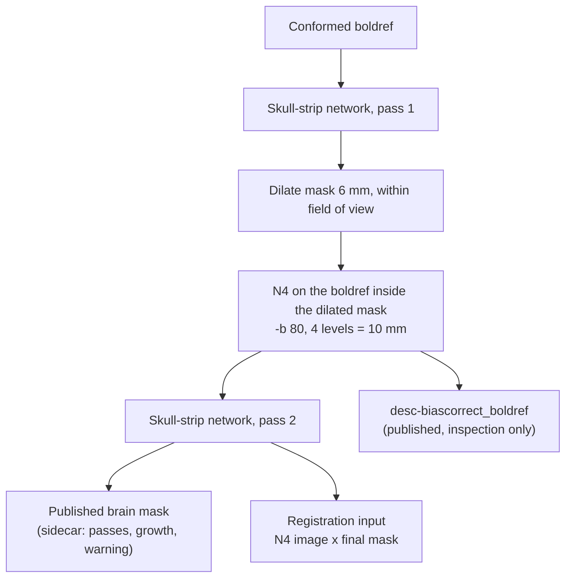

# Func skull strip under a receive-coil bias field

Field case (v3.2.0): a run whose func brain mask cut off the frontal pole, with nothing
flagged. The tmean had a strong posterior→anterior coil gradient.

Status: fixed with a two-pass skull strip (`func_skullstrip_two_pass`). A functional-only
mode (`--anat_from`) was added to rerun func on earlier anat outputs.

## Cause: func N4 runs without a mask

`func_bias_correction` runs N4 on the native tmean with no `-x`, so the fit covers the whole
field of view: background, eyes, and the bright muscle next to the coil. With `-b [100]` and
4 levels (12.5 mm final spacing), the field fits that hot spot rather than the brain-wide ramp.

In the field case:
- The network input was still about 6× darker at the front than the back (brain median by
  A-P fifth: 192 / 184 / 176 / 110 / 32).
- The N4 field spanned only 0.87–1.95.
- The network covered 11% of the frontal fifth.

## Test set and scoring

- **Images:** 205 published conformed boldrefs (the exact network input) from multiple sites,
  plus 48 raw-only runs (infants included) run through the func-only steps.
- **Reference masks:** anat brain masks where available, otherwise the template mask warped to
  bold. 153 sessions are scorable.
- **Coverage:** fraction of the reference inside the network mask, per fifth of the brain along
  each axis. `mincov` is the worst fifth.
- **Field of view:** the reference is clipped to the acquired field of view. Conform padding is
  a constant floor, not 0, so the field of view is "above the image minimum".
- **Residual bias:** brightest-fifth / darkest-fifth median brain intensity.
- **Over-correction guard:** `detail` is the fine-scale relative contrast (σ = 2 mm) after N4
  compared with before.

## N4 mask

An extra N4 pass on the conformed boldref, with each mask dilated 6 mm:

| N4 mask | mincov p10 / median | better / worse | residual median / p90 |
|---|---|---|---|
| none (current) | 0.56 / 0.79 | – | 1.48 / 2.07 |
| head | 0.51 / 0.77 | 18 / 43 | 1.21 / 2.44 |
| reference brain | 0.56 / 0.81 | 62 / 1 | 1.27 / 1.96 |
| network mask (pass 1) | 0.57 / 0.82 | 68 / 1 | 1.26 / 1.91 |

The head mask keeps the tissue the fit was chasing. The network mask matches the reference and
needs no anat.

## B-spline spacing

Only the final spacing `-b / 2^(levels−1)` matters:

| Final spacing | mincov median | better / worse | detail median / min |
|---|---|---|---|
| 5 mm | 0.841 | 106 / 1 | 0.92 / 0.76 |
| 7.5 mm | 0.823 | 87 / 3 | 0.98 / 0.91 |
| **10 mm** | **0.823** | **86 / 0** | **0.99 / 0.96** |
| 12.5 mm | 0.816 | 68 / 1 | 1.00 / 0.98 |
| ≥ 15 mm | 0.79–0.81 | 0–53 / 0 | 1.00 / 0.95 |

Below 10 mm the field absorbs anatomy. 10 mm is the knee in both halves of a random site split.

## Pass 3

Pass k runs N4 on the original boldref inside pass k−1's mask (dilated), then the network.

| Step | better / worse | added voxels, median |
|---|---|---|
| pass 2 vs pass 1 | 86 / 0 | 2.8% |
| pass 3 vs pass 2 | 1 / 1 | 0.06% |

Two passes converge, and no growth-based trigger picked out sessions that pass 3 helps, so
there is no pass 3.

## Registration input

func→anat SyN was run from the old moving image (boldref × mask) and from the new one
(N4 × mask), with the same final mask, on 108 sessions with anat.

Scoring both transforms on one image favours the transform optimised on it. NMI shows this
exactly: each transform wins on its own image (102/108 vs 0/108), and the symmetric mean is a
tie. So each transform was applied to both images and the scores averaged.

| Metric (N4 better / worse) | all | bias-heavy top 20% |
|---|---|---|
| grey/white contrast at the cortical boundary, symmetric | 81 / 27 | 19 / 3 |
| same, scored on the old image only (favours old) | 53 / 55 | 17 / 5 |
| warp magnitude (lower is better) | 79 / 29 | 14 / 8 |
| mask Dice, NMI (symmetric) | unchanged | unchanged |

The gain is modest and concentrated where the bias is strong, so registration uses the N4
image.

## Design

- **Location:** `func_skullstrip_two_pass` (`operations/preprocessing.py`), called by
  `func_skullstripping` in `FUNC_COMPUTE_BRAIN_MASK`. `apply_skullstripping` is unchanged, so
  conform (anat and func) stays single-pass.
- **Constants:** `FUNC_N4_DILATE_MM = 6`, `FUNC_N4_BSPLINE = 80`, `FUNC_N4_SHRINK = 2`, and no
  rescale, so the published image keeps the boldref's scale. No config keys.
- **QC:** above `FUNC_MASK_GROWTH_WARN = 0.10` added by pass 2, a `QC:` warning is logged and
  `MaskGrowthWarning` is set in the mask sidecar, next to `SkullstripPasses`,
  `Pass2GrowthPct`, `Pass2ShrinkPct` and `PreInferenceN4`. On the test set, pass 2 added 2.6%
  at the median and 6.9% at p90; 9 of 253 images exceeded 10%, all slab-limited or bad-input
  sessions.
- **Fallbacks:** an empty pass-1 mask, or a failed N4 or pass 2, keeps pass 1
  (`SkullstripPasses: 1`, error recorded). The step never fails here.
- **Untouched:** the published `space-bold_boldref` and the 4D BOLD are unchanged.
- **Cost:** two network passes and one N4 per mask. `FUNC_COMPUTE_BRAIN_MASK` now gets 2 CPUs.

## Not fixed

- **Slab EPI that stops short of the frontal lobe:** coverage is limited by acquisition, not
  bias. The growth warning usually fires on these.
- **One session with Dice 0.40 under every variant:** a reference or registration problem.
- **The field case:** it improves (residual 2.31 → 1.28), but the frontal tip stays partly
  clipped, probably because of real signal loss.

## Functional-only reruns (`--anat_from`)

`-resume` cannot reuse anat into a new output dir: the config and input paths and the
container are part of the task hash. `--anat_from <earlier output dir>` skips `ANAT_WF` and
rebuilds `FUNC_WF`'s six anat inputs from published files (`utils/anat_reuse.py`, run at
start-up by `collect_reused_anat.py` → `nextflow_reports/reused_anat.json`):

| `FUNC_WF` input | Source |
|---|---|
| `anat_after_bias_brain` | `*_space-T1w_desc-preproc_T1w_brain`; `bids_name` = `<prefix>_T1w.nii.gz` |
| `anat_reg_transforms` | `*_from-T1w_to-<space>` / `*_from-<space>_to-T1w` (not the `.json` sidecars) |
| `anat_reg_reference` | `resolve_template(output_space)`, as `ANAT_REGISTRATION` links it |
| `surf_actual_subject_id` | `fastsurfer/<id>`, linked into the new output (the tSNR projection reads it there) |
| `anat_skull_seg`, LUT | `*_space-T1w_desc-brain_atlas*.{nii.gz,tsv}` |

- **Output space:** the earlier run must have used the same output space. It is read from a
  `*_from-T1w_to-*_xfm.json` sidecar (`TemplateSource.OutputSpace`), falling back to
  `dataset_description.json`: every run rewrites that file at start, before the check runs,
  so on its own it can name the new run's space instead of the earlier one.
- **New output dir:** `--anat_from` equal to `--output_dir` is rejected.
- **Missing anat:** subjects without anat fall back to the template, as in a full run.
- **Not copied:** anat outputs and figures are not copied to the new output dir.
